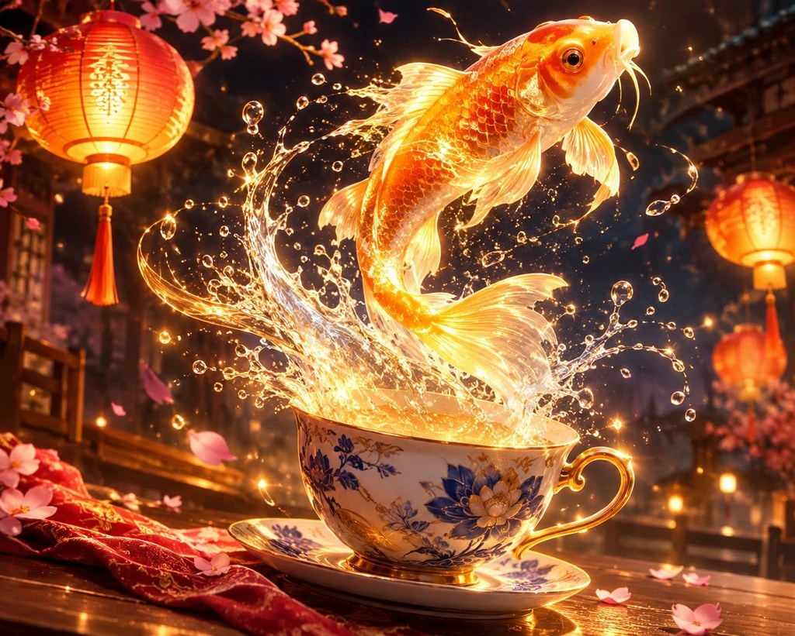

# Golden Koi from a Teacup

This is an image entry for make.fun's ai-excited-01 bounty: a golden koi leaping from a blue-and-white porcelain teacup, surrounded by red lanterns and cherry blossoms at night. It was built by an AI agent to excite the AI judge.

## How it works

`main.ts` copies `entry.png` (the golden koi image) into `$MAKEFUN_OUTPUT_DIR` (default `out`), writing it there as `entry.png`.

